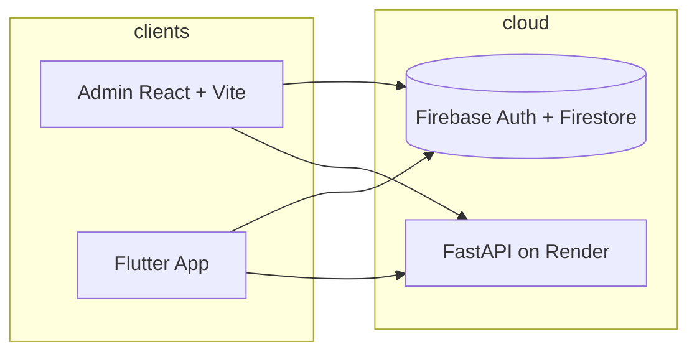

# Boon Hua Fishery — Project Architecture Overview

**Root:** `boon_hua_fishery/`  
**Apps:** `boonhua_web/` · `boon_hua_mobile/` · `boon_hua_backend/`

This document describes the web admin, mobile consumer app, backend API, methodology, OOP concepts, languages, features, data model, testing, and deployment.

---

## 1. Project overview

**Boon Hua Fishery** is a dual-platform seafood retail system for a Malaysian wet-market style shop. It connects:

| Role | App | Purpose |
|------|-----|---------|
| Shop owner / staff | **Web admin** (`boonhua_web`) | Stock, sales, credit, reports, customers |
| Consumer | **Mobile app** (`boon_hua_mobile`) | Home “virtual freezer”, prices, recipes, OCR |
| Shared services | **FastAPI backend** (`boon_hua_backend`) | AI recipes, sales forecast, seafood photo ID |
| Cloud data | **Firebase** | Auth + Firestore (source of truth) |

**Problem it solves:** shops track catch in kg and sell by weight/RM, while customers forget what they bought and when it expires. The system digitizes shop operations and helps households reduce seafood waste.

**Summary line:** Three-tier **Firebase-centric** fishery platform — React admin and Flutter consumer on Firestore, with a **Render-hosted FastAPI** layer for **Gemini/OpenAI** recipes and seafood vision, **scikit-learn** revenue forecasting, and **ML Kit** receipt OCR on device.

---

## 2. Languages & technology stack

### Web admin (`boonhua_web`)

| Layer | Choice |
|-------|--------|
| Language | JavaScript (ES modules), JSX |
| UI | React 19 + Vite 8 |
| Routing | React Router 7 |
| Styling | Tailwind CSS 4 |
| Charts | Recharts 3 |
| Data | Firebase JS SDK 12 (Auth + Firestore) |
| Exports | Client-side CSV / Excel (`xlsx`) / PDF helpers |
| Tooling | Babel React Compiler, ESLint |

### Mobile consumer (`boon_hua_mobile`)

| Layer | Choice |
|-------|--------|
| Language | Dart 3.11 |
| Framework | Flutter |
| Auth / DB | Firebase Auth, Cloud Firestore |
| OCR | Google ML Kit Text Recognition |
| Camera / crop | `image_picker`, `image_cropper` |
| Notifications | `flutter_local_notifications` |
| HTTP API | `http` → Render FastAPI |
| Local prefs | `shared_preferences` |

### Backend API (`boon_hua_backend`)

| Layer | Choice |
|-------|--------|
| Language | Python 3.12 |
| Framework | FastAPI + Uvicorn + Pydantic v2 |
| ML | scikit-learn (Gradient Boosting sales forecast), numpy |
| AI | Google Gemini and/or OpenAI (recipes, chat, photo ID) |
| Optional | Firebase Admin (inventory REST), JasperReports (sales export) |
| Deploy | Render (`https://boon-hua-fishery.onrender.com`) |

---

## 3. Methodology / architecture

### High-level style

- **Client–server + BaaS hybrid**
  - Day-to-day shop/customer data → **Firestore** (real-time)
  - Heavy AI / ML → **stateless FastAPI** on Render
- **Separation of concerns**
  - Web: `domain/` (rules) · `services/` (Firestore ops) · `utils/` · UI pages
  - Mobile: `models/` · `data/` (repository) · `services/` · screens/widgets
  - Backend: route layer (`main.py`) + service modules
- **Single source of truth:** Firestore
- **Config sync:** Admin sets mobile API URL in Settings → `app_config/public.recipeApiBaseUrl` → phone reads it via `ApiConfig`
- **Development approach:** iterative feature delivery (inventory → sales → OCR → recipes → forecast → photo ID), with requirements traced in `REQUIREMENTS_TRACEABILITY.md`

### Architecture diagram



```
Admin (React) ──onSnapshot/addDoc/updateDoc──► Firestore ◄──streams── Mobile (Flutter)
      │                                              ▲
      └──── fetch POST /sales/forecast ──────────────┤
Mobile ── HTTP ──► /recipes/*, /seafood/identify ────┘──► Render FastAPI
                                                           |-- Gemini / OpenAI
                                                           |-- scikit-learn forecast
                                                           |-- recipe catalog / TheMealDB
```

### Auth split

- `adminProfiles/{uid}` — web admin gate; mobile blocks admin-only accounts
- `customers/{uid}` — mobile consumers; web **Users** page; Suspended blocks login

### Typical flows

1. **Shop stock:** Admin writes `inventory` + `inventoryHistory` → mobile **Market** reads `inventory` live
2. **Sale:** Admin sales page → `orders` + stock deduct + history `type: 'sale'`
3. **Consumer freezer:** OCR/manual → `users/{uid}/virtualFreezer` + `priceHistory` (+ `freezerHistory` on spoil/consume)
4. **Recipes:** Mobile → `POST /recipes/suggest` or `/recipes/chat`; fallback TheMealDB + local catalog
5. **Forecast:** Overview builds daily RM series from `orders` → `POST /sales/forecast`
6. **Photo ID:** Mobile crop → `POST /seafood/identify` (Gemini preferred; OpenAI fallback)

---

## 4. OOP & design concepts applied

### Encapsulation

Domain logic bundled in classes/modules instead of scattered UI code:

- Web: `Order`, `InventoryService`, `DateUtils`, inventory/species helpers
- Mobile: `FreezerItem`, `PriceHistoryEntry`, `MarketInventoryItem`, `FirebaseRepository`, `SeafoodIdentifyService`

### Abstraction

UI talks to repositories/services, not raw Firestore everywhere:

- Mobile: `FirebaseRepository` hides collection paths and mapping
- Web: `InventoryService` abstracts stock deduct/restore/history

### Polymorphism / static behavior objects

- Web `Order` uses **static methods** as a behavior object over plain Firestore docs (`dateKey`, `total`, `amountOwing`, payment helpers)
- Flutter **Widgets** as composable UI objects (`StatelessWidget` / `StatefulWidget`)

### Single responsibility

- OCR parsing vs scanning UI (`ReceiptParser` / `ReceiptScanner`)
- Recipe HTTP vs AI chef screen
- Sales forecast utils vs Overview charts
- Spoilage ledger vs inventory CRUD

### Repository pattern

- `FirebaseRepository` (mobile) for freezer / price history / market inventory streams and CRUD

### Service layer

- Web: `InventoryService`, sales forecast helpers, report export
- Mobile: `SeafoodIdentifyService`, `RecipeSuggestionService`, `RecipeAiService`, `NotificationService`, `PriceSyncService`
- Backend: `ai_recipe_service.py`, `seafood_identify_service.py`, `sales_forecast_ml.py`, `themealdb_service.py`

### Singleton / shared instances

- `inventoryService` (web)
- `NotificationService.instance` (mobile)

### Provider / context

- `AdminNotificationProvider`, `AdminNotificationBell`, `NotificationAlert`

### Domain-driven naming (web)

| File | Role |
|------|------|
| `domain/InventorySpecies.js` | Normalize species, consolidate, stock thresholds |
| `domain/Order.js` | Totals, credit/paid, date keys, buyer/sale types |
| `domain/InventoryMovement.js` | Ledger direction, type labels, stock removal reasons |
| `domain/SeafoodCatalog.js` | Catalog entries |
| `domain/SeafoodCategory.js` | Category resolve + options |

### Mobile models & catalog

| File | Role |
|------|------|
| `models/freezer_item.dart` | `FreezerItem`, `FreezerHistoryEntry` |
| `models/price_history_entry.dart` | `PriceHistoryEntry`, `PriceNormalizer` |
| `models/market_inventory_item.dart` | Live shop price rows |
| `data/seafood_catalog.dart` | `SeafoodCatalog`, category filters |

---

## 5. Web admin features (`boonhua_web`)

| Area | Route / module | Features |
|------|----------------|----------|
| **Auth** | `App` + `resolveWebAdminSession` | Email/password; admin bootstrap `adminProfiles`; reject consumer-only |
| **Overview** | `/` — `OverviewPage` | KPIs; **last 7 days** by default; revenue + popular charts; low-stock / loss alerts; **7-day ML sales forecast**; export charts PDF |
| **Inventory** | `/inventory` | Add catch (kg, **landing/farm-gate** + **daily market** RM/kg, category); edit/delete; live daily price → mobile Market; sort/filter; **spoilage/loss valued at landing**; **stock ledger** tab |
| **Sales** | `/sales` | Sale by weight or RM; buyer types; cash / credit / pre-order; stock deduct; edit/void with restore |
| **Credit** | `/credit` | Outstanding balances; partial/full payment; WhatsApp collection links |
| **Reports** | `/reports` | Date range; buyer summary; **CSV / Excel / PDF** (optional Jasper) |
| **Users** | `/users` | Live customers; Active / Suspended |
| **Settings** | `/settings` | Store profile; admin profile; **Mobile Recipe API URL** |
| **Notifications** | Admin bell context | Low stock, period losses, collection risk; localStorage + optional Firestore prefs |

---

## 6. Mobile app features (`boon_hua_mobile`)

| Area | Screen / class | Features |
|------|----------------|----------|
| **Auth** | `AuthScreen`, gates | Register/login; block admin-only & suspended; session persistence |
| **Home** | `HomeScreen` | Freezer summary; expiring count; quick actions (scan, recipes, identify) |
| **Virtual freezer** | `FreezerScreen`, `AddItemForm` | CRUD; categories/search; photo or icon; best-before; mark loss → history |
| **OCR receipt** | `ReceiptScanner`, `ScanScreen` | Camera/gallery → ML Kit → parse → review → freezer + price history |
| **Market prices** | `MarketPricesScreen` | Live shop `inventory` prices from admin |
| **Compare** | `CompareScreen` | RM/kg normalize; price history edit/delete |
| **Recipes** | `RecipesScreen` | Meal ideas matched to freezer; filters |
| **AI chef** | `RecipeAiChefScreen` | Chat `POST /recipes/chat`; persisted history |
| **Identify seafood** | `SeafoodIdentifyScreen` | Camera/gallery → **crop** → `POST /seafood/identify` (preview; not 100% accurate) |
| **Notifications** | `NotificationService` | Local scheduled expiry reminders |
| **Settings** | `SettingsScreen` | Profile, notification prefs, store contact, logout |
| **Nav** | Bottom nav + FAB | Home · Freezer · Compare · Recipes; center FAB = scan |

**Spoilage semantics**

- **Admin:** shop `inventory` loss → `inventoryHistory`
- **Mobile:** personal freezer loss → `freezerHistory` + item status

---

## 7. Backend API

### Endpoints (`main.py`)

| Method | Path | Purpose |
|--------|------|---------|
| GET/HEAD | `/`, `/health` | Status, firebase flag, AI pointers |
| POST | `/sales/forecast` | sklearn Gradient Boosting — 7-day RM forecast |
| CRUD | `/inventory`, `/inventory/{id}` | Firestore inventory mirror (503 if no Firebase Admin) |
| GET | `/recipes/ai-status`, `/recipes/aistatus` | AI enabled + provider |
| POST | `/recipes/suggest` | AI / TheMealDB / local catalog recipes |
| POST | `/recipes/chat` | Conversational chef (Gemini or OpenAI) |
| GET | `/recipes/database` | Built-in recipe catalog |
| POST | `/seafood/identify` | Vision species ID (Gemini preferred; OpenAI fallback) |
| POST | `/reports/sales/export` | Optional Jasper PDF/XLSX/CSV |

### AI configuration

- Keys: `GEMINI_API_KEY`, `OPENAI_API_KEY`
- `AI_PROVIDER`: `auto` / `openai` / `gemini`
- Models: `GEMINI_MODEL` (default current Flash-Lite), `OPENAI_MODEL` (default `gpt-4o-mini`)
- Photo ID: prefer Gemini; OpenAI needs billing credits if used alone
- Fallbacks: TheMealDB + `recipes_data.RECIPE_CATALOG` when AI is off or fails

### Pydantic request models

`SeafoodItem`, `FreezerRecipeItem`, `RecipeRequest`, `RecipeChatRequest`, `SalesForecastRequest`, `SeafoodIdentifyRequest`, `SalesReportExportRequest`

---

## 8. Data & business rules

### Firestore collections

| Collection / doc | Used by |
|------------------|---------|
| `inventory` | Admin CRUD; mobile market; backend optional REST |
| `orders` | Sales, credit, reports, forecast |
| `inventoryHistory` | Stock ledger, spoilage, sale voids |
| `customers` | Mobile profile; admin user management |
| `adminProfiles` | Web admin gate |
| `storeSettings/main` | Store hours, phone, address |
| `app_config/public` | `recipeApiBaseUrl` |
| `adminNotificationPrefs/{id}` | Cross-device admin notification prefs |
| `users/{uid}/virtualFreezer` | Consumer freezer |
| `users/{uid}/priceHistory` | Compare tab |
| `users/{uid}/freezerHistory` | Consumer spoil/consume log |
| `users/{uid}/recipeAiChat` | AI chef transcript |

### Business rules (examples)

- Stock status from kg: **In** (>20 kg), **Low** (1–20), **Out** (0)
- Sales deduct inventory weight; spoilage can target a specific in-stock batch
- Add Catch with same species often **merges** into existing row (price updated; not true FIFO)
- Overview date range defaults to **rolling last 7 days**
- Mobile freezer is **per user**; shop inventory is **shared**

---

## 9. Testing & quality

| Location | Type | What |
|----------|------|------|
| `boonhua_web/src/shopPhoneFlow.test.js` | Node `node:test` | Shop↔phone flow helpers |
| `boon_hua_mobile/test/receipt_parser_test.dart` | Flutter test | Receipt parser |
| `boon_hua_mobile/test/shop_phone_flow_test.dart` | Flutter test | Cross-flow assertions |
| `REQUIREMENTS_TRACEABILITY.md` | UAT checklist | Manual acceptance scenarios |

Requirements map functional and non-functional items (account, inventory, OCR, freezer, alerts, recipes, security, maintainability) to implementation.

**Gaps:** Limited backend unit tests; no full E2E browser suite.

---

## 10. Deployment & operations

| Component | Target | Mechanism |
|-----------|--------|-----------|
| **API** | Render | `render.yaml` (`rootDir: boon_hua_backend`), `uvicorn main:app`, health `/` |
| **Firebase** | Auth + Firestore | Client SDKs; optional Admin SDK on server |
| **Web** | Local / static host | `npm run build` → `dist/` |
| **Mobile** | Android / iOS | `flutter run` / release builds |

### Typical Render environment

- `PYTHON_VERSION`
- `GEMINI_API_KEY` (recommended for recipes + photo ID)
- `OPENAI_API_KEY` (optional / recipes if preferred)
- `GEMINI_MODEL` (e.g. `gemini-3.5-flash-lite` — avoid shut-down `gemini-2.0-*` IDs)
- `FIREBASE_CREDENTIALS_JSON` (optional inventory REST)
- Optional Jasper vars for server-side report export

### Local quick start

```bash
# Web
cd boonhua_web && npm install && npm run dev

# Backend
cd boon_hua_backend && pip install -r requirements.txt
uvicorn main:app --reload --port 8000

# Mobile
cd boon_hua_mobile && flutter pub get && flutter run
```

Set admin **Settings → Mobile Recipe API** to the Render URL (or local API for debug).

---

## 11. Repository layout

```
boon_hua_fishery/
├── boon_hua_backend/     # FastAPI
├── boonhua_web/          # React admin
├── boon_hua_mobile/      # Flutter consumer
├── docs/
│   └── project_architecture.md   # this file
├── README.md
├── REQUIREMENTS_TRACEABILITY.md
└── render.yaml
```

---

*Last updated for the Boon Hua Fishery monorepo architecture as implemented in this codebase.*
